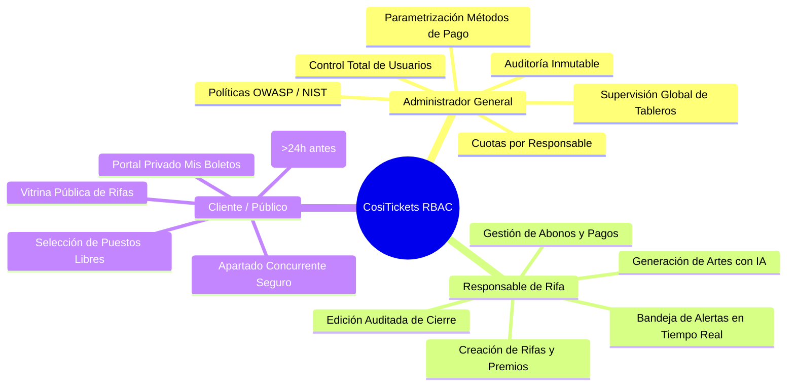
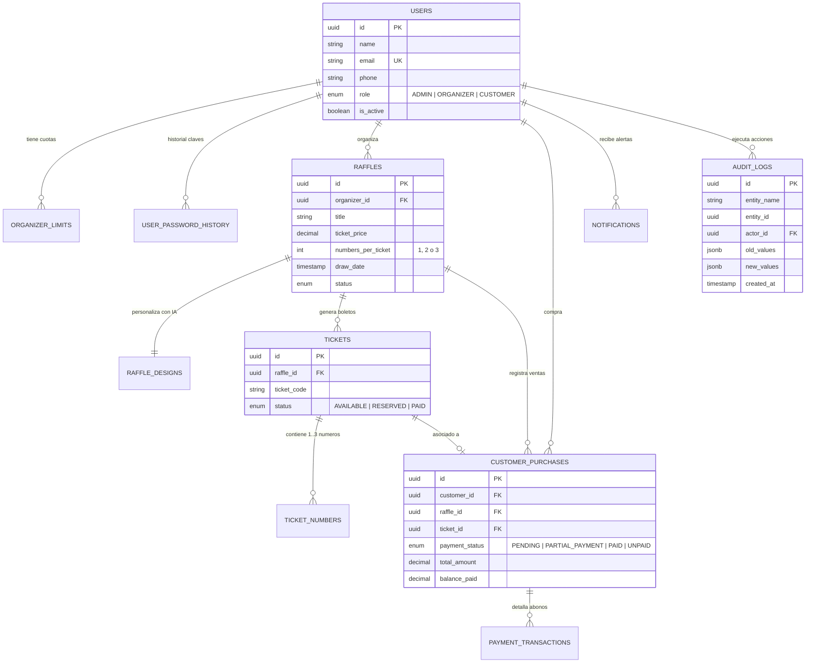
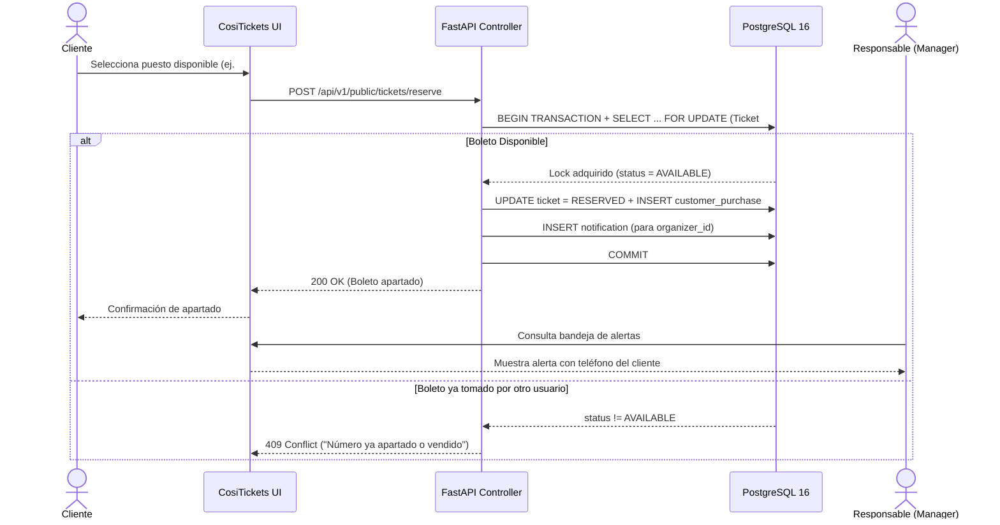
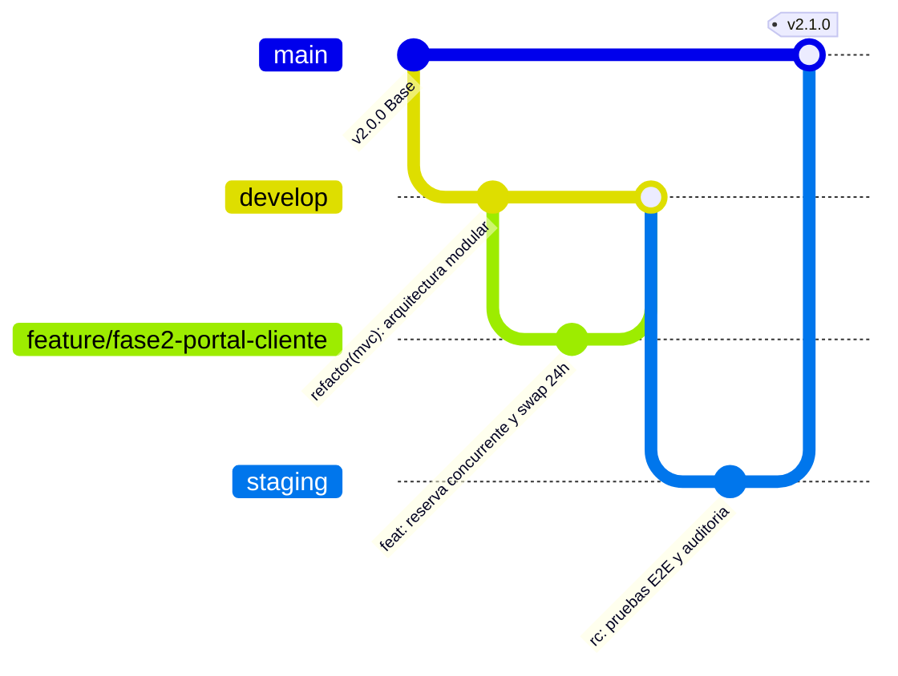
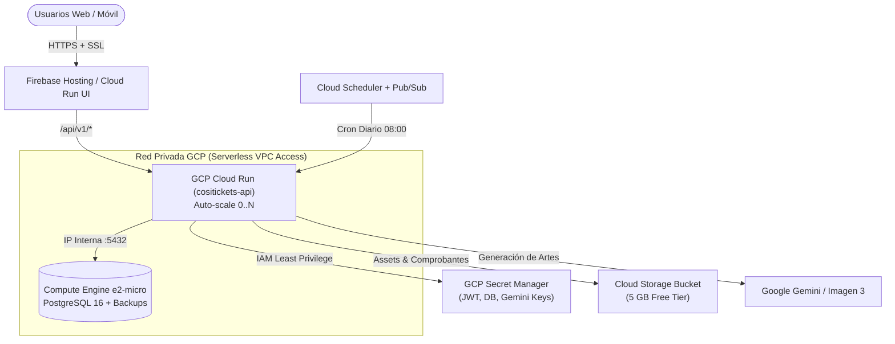

# 🎟️ CosiTickets — Plataforma Corporativa de Rifas Virtuales


**CosiTickets** es una plataforma web *full-stack* diseñada para la creación, administración, comercialización, diseño asistido por Inteligencia Artificial y auditoría de rifas virtuales. Está construida bajo un enfoque de alta seguridad, control estricto de concurrencia transaccional y arquitectura limpia **MVC (Modelo-Vista-Controlador)** gobernada por agentes internos de validación y despliegue continuo.

---

## 📋 Tabla de Contenidos

1. [Propuesta de Valor y Ventajas Competitivas](#-propuesta-de-valor-y-ventajas-competitivas)
2. [Alcance Funcional por Rol (RBAC)](#-alcance-funcional-por-rol-rbac)
3. [Enfoque Técnico y Arquitectónico](#-enfoque-técnico-y-arquitectónico)
4. [Modelo de Datos Relacional](#-modelo-de-datos-relacional)
5. [Flujos Críticos del Sistema](#-flujos-críticos-del-sistema)
6. [Agentes Internos de Gobernanza e IA](#-agentes-internos-de-gobernanza-e-ia)
7. [Arquitectura de Ambientes y Estrategia GitFlow](#-arquitectura-de-ambientes-y-estrategia-gitflow)
8. [Despliegue Local en Docker (VS Code)](#-despliegue-local-en-docker-vs-code)
9. [Arquitectura Objetivo en Google Cloud Platform](#-arquitectura-objetivo-en-google-cloud-platform)

---

## 🚀 Propuesta de Valor y Ventajas Competitivas

| Ventaja Clave | Descripción Técnica y de Negocio |
| :--- | :--- |
| **Cero Colisiones de Venta** | Uso de bloqueo pesimista a nivel de fila en PostgreSQL (`SELECT ... FOR UPDATE`) que garantiza que dos compradores nunca puedan reservar o adquirir el mismo número simultáneamente. |
| **Flexibilidad de Tableros** | Configuración dinámica de rangos numéricos (ej. `00` a `99`) con asignación automática de **1, 2 o 3 números por boleto**, adaptándose a rifas rápidas o sorteos mayores. |
| **Estudio Creativo con IA Generativa** | Integración con **Google Gemini / Imagen 3** mediante un motor de reintentos y cascada de hasta 3 modelos de respaldo (*fallbacks*) que genera banners y plantillas de tickets desde un *prompt*. |
| **Trazabilidad y Auditoría Inmutable** | Todo cambio crítico (como modificación de fechas de cierre o precios) exige una justificación obligatoria y persiste un registro inmutable (`old_values` vs `new_values`) en `audit_logs`. |
| **Seguridad Dinámica OWASP / NIST** | Contraseñas cifradas con **Argon2id**, historial de rotación, autenticación **JWT** y políticas de complejidad parametrizables en caliente por el Administrador. |
| **Optimización de Costos Cloud** | Diseñada nativamente para operar sobre el **Always Free Tier de Google Cloud Platform** (Cloud Run + Compute Engine `e2-micro` + GCS + Cloud Scheduler). |

---

## 👥 Alcance Funcional por Rol (RBAC)



### 1. Administrador General (`ADMIN`)
* **Gobernanza de Usuarios:** Creación, activación y suspensión de cuentas para cualquier rol (`ADMIN`, `ORGANIZER`, `CUSTOMER`).
* **Control de Cuotas Operativas:** Definición de límites máximos de rifas totales y mensuales por cada Responsable de Rifa.
* **Consola de Seguridad Dinámica:** Parametrización de longitud mínima, caracteres especiales, expiración e historial de contraseñas.
* **Supervisión e Inspección:** Vista consolidada de rifas agrupadas por responsable, vista previa de tableros en tiempo real y visor de auditoría (`audit_logs`).

### 2. Responsable de Rifa / Manager (`ORGANIZER`)
* **Configuración de Sorteos:** Definición de premios, valor del boleto, rango numérico, modalidad (1, 2 o 3 números por boleto) y fecha de cierre.
* **Agente IA de Diseño:** Generación de imagen de fondo del tablero y plantilla gráfica del ticket mediante *prompts* personalizados.
* **Gestión de Cobranza en Tablero:** Edición directa sobre cualquier casilla para registrar datos del comprador, forma de pago (*Efectivo, Nequi, Daviplata, Transferencia*), abonos parciales, observaciones y transición de estados (`AVAILABLE` $\rightarrow$ `RESERVED` $\rightarrow$ `PAID`).
* **Centro de Notificaciones:** Alertas instantáneas cuando un cliente aparta o cambia un número, además de resúmenes diarios de avance y días restantes para el sorteo.

### 3. Cliente / Participante (`CUSTOMER` y Vista Pública)
* **Tablero Público Interactivo:** Visualización en tiempo real del porcentaje de avance, números libres, abonados y pagados con la identidad visual de la rifa.
* **Reserva Concurrente:** Apartado rápido de puestos con creación/vinculación automática de perfil de cliente.
* **Autogestión de Cambio de Número:** Posibilidad de cambiar un número apartado por otro disponible **hasta 24 horas antes** de la fecha del sorteo, notificando automáticamente al responsable.
* **Portal *"Mis Boletos"*:** Consulta centralizada de boletos adquiridos, saldos abonados, saldo pendiente y número ganador tras el cierre.

---

## 🏗️ Enfoque Técnico y Arquitectónico

El sistema implementa una arquitectura desacoplada de **3 capas contenerizadas** bajo el patrón **MVC estricto** tanto en Backend como en Frontend:

```mermaid
flowchart LR
    subgraph Client["Capa Presentación (React 18 + TS + Tailwind)"]
        Views["Views (Auth, BoardModal, TicketManager)"]
        CtrlUI["Controller Hook (useCosiController)"]
        SvcUI["HTTP Service (api.ts + JWT)"]
        Views <--> CtrlUI <--> SvcUI
    end

    subgraph Proxy["Gateway / Reverse Proxy"]
        Nginx["Nginx Alpine (:3000)"]
    end

    subgraph Backend["Capa Aplicación MVC (FastAPI Python 3.12)"]
        Routers["Views API (app/routers/*)"]
        Controllers["Controllers (app/controllers/*)"]
        Models["ORM Models (app/models/*)"]
        Agents["Agentes Internos (IA + Guard + Deploy)"]
        Routers --> Controllers
        Controllers --> Models
        Controllers -.-> Agents
    end

    subgraph Data["Capa Persistencia & Servicios Externos"]
        PG[("PostgreSQL 16 (:5432)")]
        Gemini["Google Gemini / Imagen 3 API"]
    end

    SvcUI -->|HTTPS / REST| Nginx
    Nginx -->|/api/v1/*| Routers
    Models <-->|SQLAlchemy ACID + FOR UPDATE| PG
    Agents -->|Cascada Fallbacks| Gemini
```



### Estructura del Monorepo

```text
cosiTickets/
├── docker-compose.yml                 # Orquestación maestra (API + UI + Red interna)
├── .env.example                       # Plantilla segura de variables de entorno
├── setup_git.ps1                      # Inicialización Git, hooks MVC y ramas
├── cositickets-api/                   # Backend RESTful (FastAPI + SQLAlchemy)
│   ├── Dockerfile
│   ├── requirements.txt
│   └── app/
│       ├── main.py                    # Orquestador limpio de FastAPI y Routers
│       ├── core/                      # Configuración, DB Pool, Argon2id, JWT y RBAC
│       ├── models/                    # Entidades relacionales SQLAlchemy
│       ├── schemas/                   # Contratos de validación Pydantic v2
│       ├── controllers/               # Lógica de negocio pura y transacciones ACID
│       ├── routers/                   # Endpoints HTTP delgados (Vistas API)
│       └── agents/                    # Agente IA, Validador MVC y Auto-Deploy
└── cositickets-ui/                    # Frontend SPA (React + Vite + Nginx)
    ├── Dockerfile                     # Build multi-stage (Node 20 -> Nginx Alpine)
    ├── nginx.conf                     # Enrutamiento SPA y proxy /api/
    └── src/
        ├── models/                    # Interfaces TypeScript fuertemente tipadas
        ├── services/                  # Cliente HTTP centralizado
        ├── controllers/               # Hook controlador de estado y reglas UI
        ├── views/                     # Componentes visuales puros desacoplados
        └── App.tsx                    # Enrutador principal por rol
```

---

## 🗄️ Modelo de Datos Relacional

El esquema en **PostgreSQL 16** garantiza integridad referencial, unicidad de números por rifa y trazabilidad completa:



---

## 🔄 Flujos Críticos del Sistema

### Reserva Concurrente, Notificación y Cambio de Número (< 24h)



---

## 🤖 Agentes Internos de Gobernanza e IA

El proyecto incorpora tres agentes especializados dentro de `cositickets-api/app/agents/`:

1. **Agente Generativo de Diseño (`ai_design_agent.py`):**
   * Procesa el *prompt* del organizador para producir el fondo del tablero y la plantilla del ticket.
   * Implementa una **cascada de resiliencia** configurable desde `.env`: intenta con el modelo principal (`GEMINI_PRIMARY_IMAGE_MODEL`) y, ante límites de cuota (`429`) o latencia, conmuta automáticamente hasta por **3 modelos alternativos** (`GEMINI_FALLBACK_MODEL_1..3`) con reintentos exponenciales.
2. **Agente Validador de Arquitectura (`architecture_guard.py`):**
   * Analiza el árbol sintáctico abstracto (**AST**) de Python y los componentes TypeScript/React.
   * Está integrado como **Git Hook (`pre-commit`)**, bloqueando cualquier *commit* que introduzca consultas SQL en routers, endpoints directos en `main.py` o llamadas `fetch()` dentro de las vistas de React.
3. **Agente de Despliegue Continuo (`deploy_agent.py`):**
   * Automatiza en un solo comando la auditoría MVC, la compilación de imágenes Docker, la verificación de salud HTTP (`/api/v1/system/health`), el versionamiento SemVer y el `git push` hacia GitHub.

---

## 🌿 Arquitectura de Ambientes y Estrategia GitFlow



| Ambiente | Rama Git | Versionamiento | Infraestructura | Base de Datos |
| :--- | :--- | :--- | :--- | :--- |
| **Desarrollo Local** | `feature/*` $\rightarrow$ `develop` | `2.1.0-dev.<sha>` | Docker Compose local (`VS Code`) | PostgreSQL 16 (`cosi_postgres_local`) |
| **QA / Staging** | `staging` / `release/vX.Y` | `2.1.0-rc.<build>` | GCP Cloud Run (`stg-*`) | PostgreSQL `cositickets_stg` |
| **Producción** | `main` (Protegida) | `v2.1.0` (SemVer Tag) | GCP Cloud Run (`prod-*`) | PostgreSQL VM `e2-micro` (`cositickets_prod`) |

---

## 💻 Despliegue Local en Docker (VS Code)

### 1. Requisitos Previos
* Docker Desktop activo.
* Python 3.11+ (para ejecución local de agentes de validación y despliegue).
* Contenedor PostgreSQL local (`cosi_postgres_local`) en ejecución en el puerto `5432`.

### 2. Configuración y Arranque
```powershell
# 1. Clonar el repositorio y ubicarse en la rama de desarrollo
git clone https://github.com/cosiatoapps/cosiTickets.git
cd cosiTickets
git checkout develop

# 2. Configurar variables de entorno
Copy-Item .env.example .env

# 3. Asegurar base de datos y levantar contenedores (API + Web UI)
docker start cosi_postgres_local
docker compose up -d --build
```

### 3. Accesos y Credenciales de Prueba
* **Aplicación Web (Frontend):** `http://localhost:3000`
* **Documentación Interactiva API (Swagger):** `http://localhost:8000/docs`

| Rol | Correo Electrónico | Contraseña |
| :--- | :--- | :--- |
| **Administrador General** | `admin@cositickets.com` | `Password@2026!` |
| **Responsable de Rifa** | `mariana.rifas@cositickets.com` | `Password@2026!` |
| **Cliente** | `juan.perez@email.com` | `Password@2026!` |

### 4. Flujo de Compilación y Push Automatizado
Para validar arquitectura, recompilar contenedores Docker y subir cambios a GitHub en un solo paso:
```powershell
python cositickets-api/app/agents/deploy_agent.py -m "feat(modulo): descripcion del cambio"
```

---

## ☁️ Arquitectura Objetivo en Google Cloud Platform

Diseñada para maximizar el **Always Free Tier** de GCP con aislamiento de red privada:



---

<p align="center">
  Desarrollado por <strong>cosiatoApps</strong> • Arquitectura MVC + Docker + FastAPI + React + PostgreSQL 16
</p>

---

<!-- AUTO-STATUS:START -->
> **Versión Activa:** `v2.1.1` | **Rama:** `develop` | **Último Build Docker Verificado:** `2026-11-12 17:13`

### 📊 Estado de Módulos Backend (Auto-generado por `deploy_agent.py`)

| Módulo Router | Archivo | Endpoints Activos |
| :--- | :--- | :---: |
| **Admin** | `app/routers/admin_router.py` | `7` |
| **Auth** | `app/routers/auth_router.py` | `2` |
| **Customer** | `app/routers/customer_router.py` | `5` |
| **Organizer** | `app/routers/organizer_router.py` | `7` |
| **System** | `app/routers/system_router.py` | `3` |
| **Total API REST** | **5 Routers Modulares** | **`24`** |
<!-- AUTO-STATUS:END -->

## 🚀 Historial de Despliegues Verificados

<!-- AUTO-DEPLOY-LOG:START -->
- **`v2.1.1`** (`2026-11-12 17:13` · `develop`): fix(board): importar RaffleDesign y PaymentTransaction en CustomerController
- **`v2.1.1`** (`2026-11-12 17:10` · `develop`): docs(readme): automatizar actualizacion de metricas y changelog en deploy_agent
<!-- AUTO-DEPLOY-LOG:END -->
